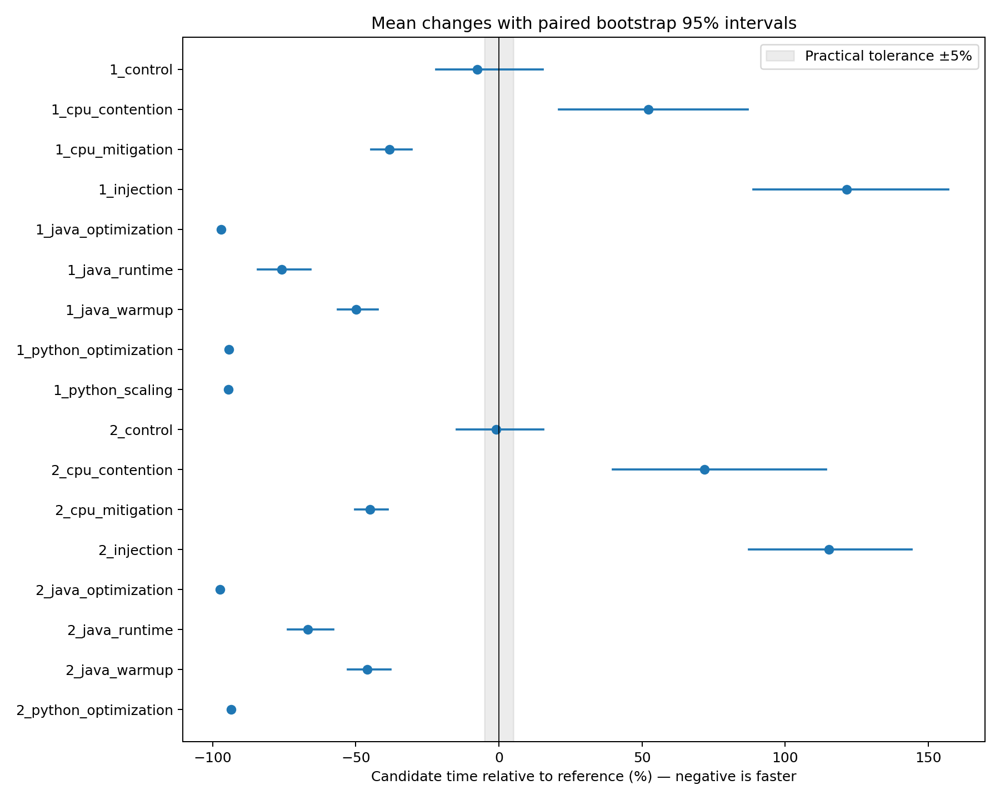

# Measured evaluation results

The primary table comes from completed fresh measurements in this suite. The later recovered-data comparison is explicitly historical. No simulated timings are mixed into these results. Internal operation times exclude setup/startup and are not full-application latency.

| Comparison | Reference ms | Candidate ms | Change % | 95% CI % | Classification |
|---|---:|---:|---:|---|---|
| 1_control | 11.6806 | 10.7926 | -7.60 | [-21.84, +15.36] | inconclusive |
| 1_cpu_contention | 13.4506 | 20.4856 | +52.30 | [+20.90, +87.00] | regression |
| 1_cpu_mitigation | 19.2024 | 11.8805 | -38.13 | [-44.70, -30.38] | improvement |
| 1_injection | 9.8632 | 21.8444 | +121.47 | [+88.85, +157.11] | regression |
| 1_java_optimization | 12.4959 | 0.3624 | -97.10 | [-97.44, -96.70] | improvement |
| 1_java_runtime | 1.4685 | 0.3548 | -75.84 | [-84.25, -65.82] | improvement |
| 1_java_warmup | 0.6481 | 0.3251 | -49.85 | [-56.26, -42.26] | improvement |
| 1_python_optimization | 21.2456 | 1.2068 | -94.32 | [-94.99, -93.60] | improvement |
| 1_python_scaling | 46.3082 | 2.5795 | -94.43 | [-94.94, -93.87] | improvement |
| 2_control | 10.6709 | 10.5702 | -0.94 | [-14.65, +15.50] | inconclusive |
| 2_cpu_contention | 13.6379 | 23.4365 | +71.85 | [+39.79, +114.27] | regression |
| 2_cpu_mitigation | 22.0503 | 12.1133 | -45.07 | [-50.29, -38.90] | improvement |
| 2_injection | 9.3895 | 20.2242 | +115.39 | [+87.42, +144.14] | regression |
| 2_java_optimization | 13.1388 | 0.3451 | -97.37 | [-97.62, -97.08] | improvement |
| 2_java_runtime | 1.2112 | 0.4036 | -66.68 | [-73.77, -57.80] | improvement |
| 2_java_warmup | 0.8558 | 0.4625 | -45.96 | [-52.87, -37.86] | improvement |
| 2_python_optimization | 17.1656 | 1.1200 | -93.48 | [-94.57, -92.19] | improvement |

## Classifier validation

Trials here are whole 20-pair comparisons, not inner timing loops. Exact binomial intervals below are descriptive and assume independent comparable trials; the two sessions share a host, so independence/generalization is limited. Two trials cannot establish a reliable general false-positive or detection rate.

- False regression flags: 0/2; exact 95% binomial interval [0.0%, 84.2%]. Outcomes: inconclusive, inconclusive.

- Detected injected slowdowns: 2/2; exact 95% binomial interval [15.8%, 100.0%]. Outcomes: regression, regression.

## Noise and mitigation

CV is sample SD / mean. Lower CV is not automatically less bias or a better estimator. CV-ratio intervals use 2000 paired bootstrap draws and are exploratory. A mitigation may change average duration without reducing variation.

- 1_cpu_contention: CV 35.67% → 32.67%; candidate/reference CV ratio 95% interval [0.54, 5.32]. See per-pair plot and Java warmup traces where applicable.

- 1_cpu_mitigation: CV 24.38% → 8.32%; candidate/reference CV ratio 95% interval [0.23, 0.52]. See per-pair plot and Java warmup traces where applicable.

- 1_java_warmup: CV 28.18% → 12.07%; candidate/reference CV ratio 95% interval [0.24, 0.89]. See per-pair plot and Java warmup traces where applicable.

- 2_cpu_contention: CV 13.97% → 46.94%; candidate/reference CV ratio 95% interval [1.20, 6.82]. See per-pair plot and Java warmup traces where applicable.

- 2_cpu_mitigation: CV 25.38% → 12.28%; candidate/reference CV ratio 95% interval [0.18, 0.80]. See per-pair plot and Java warmup traces where applicable.

- 2_java_warmup: CV 21.85% → 22.29%; candidate/reference CV ratio 95% interval [0.55, 2.94]. See per-pair plot and Java warmup traces where applicable.

## No regression and absolute targets

The graph target is a preselected illustrative mean-operation budget of 3 ms, not a real application SLA. Assessment uses the observed mean; it makes no tail-latency or confidence guarantee.
- 1_control: {'reference': False, 'unchanged': False}.
- 1_python_optimization: {'repeated_BFS': False, 'reuse_BFS': True}.
- 1_python_scaling: {'repeated_BFS': False, 'reuse_BFS': True}.
- 2_control: {'reference': False, 'unchanged': False}.
- 2_python_optimization: {'repeated_BFS': False, 'reuse_BFS': True}.

## Comparative methodology evaluation

Paired interval classification quantifies uncertainty and can remain inconclusive. A point-estimate-only ±5% rule cannot express uncertainty. The minimum-time ratio is recorded in comparisons.csv; it describes best observed timings and is not the mean-change estimand. No significance test is performed on minima.

Point-only versus interval classification differs for 2 of 17 comparisons: 1_control, 2_control.

The deliberately large effects in this suite are easy cases; agreement does not establish that point-only classification is generally adequate.

Warmup traces allow inspection but no changepoint analysis or steady-state proof is implemented. Process-wall means in comparisons.json include startup/setup; never substitute them for internal times when interpreting the optimization magnitude.

## Repeatability and limitations

Session 2 is a preplanned held-out confirmation with fresh processes and a different order seed. It is same-host repeatability, not reproduction on another machine. The suite provides limited workloads, one host and JVM, no power calculation, approximate bootstrap coverage, no multiple-testing adjustment, and no measurements of energy, memory or end-to-end user impact. Source/runtime effects are conditional on these exact workloads. Large improvements from deliberately redundant BFS or linear search do not establish improvements across all of NetworkX or Java.

All original project results remain separate. Five supplied NetworkX/NumPy datasets were recovered and their stored analyses exactly recomputed in results/original-audit.json.

## Recovered original data: uncertainty changes the decision

This table reuses the previous group’s raw data, whose analysis was checked exactly. These are not new timings or additional validation trials.

| Historical dataset | Pairs | Mean change % | Point-only ±5% | Paired-CI decision |
|---|---:|---:|---|---|
| original\misc\experiments\20261018_175350_179456Z | 20 | +0.56 | within_threshold | within_threshold |
| original\misc\experiments\20261018_180546_746006Z | 30 | +1.49 | within_threshold | inconclusive |
| original\misc\numpy-experiment\experiments\20261019_153028_921829Z | 5 | +195.40 | regression | regression |
| original\misc\numpy-experiment\experiments\20261019_153158_134656Z | 20 | +236.08 | regression | regression |
| original\misc\numpy-experiment\experiments\20261019_154453_136230Z | 20 | +9.93 | regression | inconclusive |

In the original NumPy unchanged-version control, +9.93% would trigger a point-only regression alarm, while the interval [-1.77%, +26.22%] yields inconclusive. In the 30-pair original NetworkX case, +1.49% is inside the point tolerance, but its interval extends to +7.03%, so the interval rule remains inconclusive. These examples show the role of uncertainty; they do not estimate general classifier accuracy.
